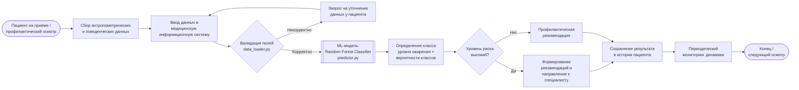

# Место ML-модели в бизнес-процессе проекта

## 1. Схема процесса

## 2. Какую задачу решает модель
Модель выполняет мультиклассовую классификацию уровня риска ожирения (7 классов: Insufficient_Weight, Normal_Weight, Overweight_Level_I, Overweight_Level_II, Obesity_Type_I, Obesity_Type_II, Obesity_Type_III) на основе антропометрических, поведенческих и диетологических признаков пациента. В бизнес-процессе модель выступает «вторым мнением» для врача: по введённым данным она автоматически определяет вероятный класс и выдаёт вектор вероятностей, помогая выявить риск на ранней стадии до появления явных клинических симптомов.

## 3. Почему целесообразно использовать ML
- Задача плохо формализуется правилами. Границы между соседними классами (например, Overweight_Level_I и Overweight_Level_II) размыты и зависят от комбинации десятков факторов — ИМТ, возраста, привычек питания, физической активности, семейного анамнеза. Экспертное дерево решений было бы громоздким и неточным.

- Нелинейные зависимости между признаками. Взаимодействия (например, «высокая калорийность + низкая активность + наследственность») дают неаддитивный эффект, который хорошо улавливают ансамбли деревьев. Random Forest показал F1-score 0.818 и ROC-AUC 0.954 — существенно выше логистической регрессии- , что подтверждает нелинейность задачи.

- Экономический эффект. Раннее выявление риска снижает затраты на лечение поздних стадий ожирения и сопутствующих заболеваний (диабет 2 типа, ССЗ). Автоматическая предклассификация при осмотре экономит время врача.

- Масштабируемость. Модель позволяет проводить скрининг на потоке пациентов без привлечения дополнительного персонала.

## 4. Входные данные
На вход модели поступает один вектор признаков пациента в формате, соответствующем ObesityDataSet.csv [Ссылка на используемый датасет](https://www.kaggle.com/competitions/playground-series-s4e2/data) (16 исходных признаков после feature engineering, включая производный BMI):

|Категория|Признаки| 
|Антропометрия|Gender, Age, Height, Weight, BMI (производный)| 
|Пищевые привычки|FCVC (овощи), NCP (число приёмов пищи), CAEC (еда между приёмами), CH2O (вода), FAVC (высококалорийная еда), CALC (алкоголь)| 
|Образ жизни|FAF (физ. активность), TUE (время перед экраном), SMOKE, SCC (калорийный мониторинг)| 
|Анамнез|family_history_with_overweight| 

| Категория    | Признаки | 
|-----------|----------| 
| **Антропометрия** | Gender, Age, Height, Weight, BMI (производный) | 
| **Пищевые привычки** | FCVC (овощи), NCP (число приёмов пищи), CAEC (еда между приёмами), CH2O (вода), FAVC (высококалорийная еда), CALC (алкоголь) | 
| **Образ жизни** | FAF (физ. активность), TUE (время перед экраном), SMOKE, SCC (калорийный мониторинг) | 
| **Анамнез** | family_history_with_overweight | 

Формат и требования:

- Вход — JSON/dict или pandas DataFrame с одной строкой, типы и диапазоны валидируются в data_loader.py.

- Категориальные признаки кодируются в соответствии с обученным Pipeline (препроцессинг сохранён вместе с моделью в models/).

- Пропуски не допускаются — на этапе валидации (шаг D) некорректные записи возвращаются на уточнение.

- Модель работает в режиме inference (не обучается в production); артефакт загружается из models/.

## 5. Как используется результат
Результат predict() — предсказанный класс и вектор вероятностей по 7 классам — используется следующим образом:

- Отображение врачу. Класс + вероятности показываются в карточке пациента в МИС как предварительная оценка (не заменяет диагноз).

- Маршрутизация. Если предсказан класс Obesity_Type_* или высокая вероятность Overweight_Level_II — система формирует направление к эндокринологу/диетологу и предлагает шаблон рекомендаций.

- Профилактика. Для Normal_Weight / Insufficient_Weight выдаётся стандартная профилактическая рекомендация.

- Мониторинг. Результат сохраняется в истории пациента; при повторных осмотрах отслеживается динамика класса.

- Обратная связь для дообучения. Подтверждённый врачом диагноз может пополнять датасет для периодического переобучения модели (feedback loop). Порог уверенности и политика переобучения настраиваются в config.py.

Важно: модель является инструментом поддержки принятия решений (CDSS), а не самостоятельным диагностическим средством. Финальное решение всегда принимает врач.